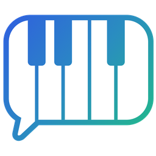
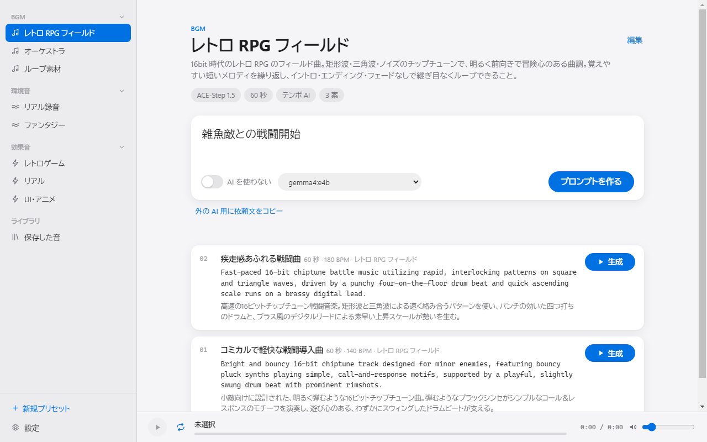

# NSSoundMaker

**言葉で頼むと、音になる。**

「雑魚敵との戦闘開始」「洞窟の水滴」「決定ボタン」——短い文言から、ゲームや動画に使う **BGM・環境音・効果音** を作ります。
AI が文言を音声モデル用のプロンプトに書き起こし、あなたの PC の ComfyUI が音にします。

[**ダウンロード**](../../releases/latest) · [入れ方](#入れ方) · [できること](#できること) · [よくある質問](#よくある質問)

<picture>
  <source media="(prefers-color-scheme: dark)" srcset="docs/screenshot-dark.png">
  
</picture>

画面の中身は見本です。

---

## できること

### 🎼 プリセットで方向性を揃える
- 「レトロ RPG フィールド」「リアル録音」「UI・アニメ」のように、**作品の方向性をプリセットに書いておく**
- 毎回書くのは「何の音か」だけ。ジャンル・音色・質感はプリセットが毎回足してくれるので、作った音どうしの雰囲気が揃います
- BGM・環境音・効果音に分けて並べ、ドラッグで並べ替え、右クリックで複製・削除
- **プリセットはファイルにして配れます。** もらったファイルはウィンドウに落とすだけで使えます。チームで音の方向性を揃えるのに
- 方向性の文章（前提プロンプト）は、キーワードを渡せば AI が英語と日本語訳で書いてくれます

### ✍️ AI がプロンプトを書く
- 文言とプリセットから、**音声モデル用の英語のプロンプトを数案**。長さ・テンポ・調も案ごとに決めます
- 案にはそれぞれ日本語訳が付くので、何を頼んでいるか読めます。英語はその場で書き直せます
- 書く AI は **Ollama（この PC の中）** か、**ログイン済みの Claude Code** から選べます
- AI を使わず、英語のプロンプトを自分で書くこともできます

### 🔊 押すたびに違う音
- 気に入った案の「生成」を押すと、ComfyUI が音にします。**押すたびに別の音**になるので、何度か作って選べます
- その場で試聴（ループ・シーク・音量）、波形の表示、気に入ったものだけ名前を付けて保存
- 保存の形式は **FLAC・OGG（Vorbis）・WAV** から選べます。OGG なら軽く、Godot や Unity にそのまま入れられます
- 保存した音は「保存した音」に一覧。プロンプトを生成画面に戻して作り直すこともできます

### 🎚 音声モデルを選べる
| モデル | 向き |
|---|---|
| ACE-Step 1.5 | BGM。曲の構成・テンポ・調まで指示でき、長い曲も作れる |
| Stable Audio Open 1.0 | 効果音・環境音。軽い（最長 47 秒） |
| Stable Audio 3 Medium | 効果音・環境音・曲のどれも。高品質だが重い（VRAM 10GB 前後） |

モデルは設定からダウンロードできます。プリセットごとに使うモデルを決められます。

### 🤖 ほかの AI から使う（MCP）
- 設定の「登録する」を押すと、**ほかのセッションの Claude Code から** プリセットを作れます
- 「このゲームの企画書に合うプリセットを作って」と頼めば、世界観を揃えて場面ごとに並べてくれます
- **音を作るところまで頼めます。** 「町の BGM を 3 案と、決定音・キャンセル音を作って」のように頼めば、プロンプトを書いて生成し、「保存した音」に入れてくれます
- Claude Desktop や Cursor など、MCP に対応したほかの AI にも設定を渡せます
- **AI を使わず HTTP でも呼べます。** 設定でオンにすると、`POST http://127.0.0.1:8790/generate` のようにスクリプトやほかのツールから音を作れます（この PC からだけ・アプリを開いているあいだだけ）

### 🔄 自動の更新
- 起動時に新しい版を確かめ、見つかると上に知らせが出ます。押すとダウンロードして入れ替えます

---

## 入れ方

> [!IMPORTANT]
> 音を作るのは **[Comfy Desktop](https://www.comfy.org/download)**（ComfyUI）です。先に入れて一度起動し、初回のセットアップを済ませてください（そのあとは閉じていて構いません）。
> NVIDIA の GPU（VRAM 8GB 以上、Stable Audio 3 は 10GB 前後）を想定しています。

1. [最新版](../../releases/latest) から **`NSSoundMaker-setup-<版>.exe`** を落として実行
2. 「Windows によって PC が保護されました」と出たら **「詳細情報」→「実行」**（署名していないためです）
3. スタートメニューの **NSSoundMaker** から起動
4. **設定** → 「音を作る AI」で、使いたい音声モデルをダウンロード（数 GB あります）
5. プロンプトを書く AI を用意する。どちらか一方で足ります
   - **[Ollama](https://ollama.com/download)** を入れる。モデルは設定の「プロンプトを作る AI」から落とせます
   - **[Claude Code](https://docs.anthropic.com/claude-code)** を入れてログインしておく（使用量はそのアカウントの枠から）

ComfyUI と Ollama は、アプリが必要なときに裏で起こします。自分で立ち上げておく必要はありません。

---

## データの置き場所

| | |
|---|---|
| 作った音 | `ドキュメント\NSSoundMaker`（設定で変えられます） |
| 設定・プリセット | `%APPDATA%\NSSoundMaker` |
| 音声モデル | Comfy Desktop のモデルの置き場所（ほかの ComfyUI の作業と共用） |

どれも更新やアンインストールでは消えません。

---

## よくある質問

<b>作った音はゲームや動画に使えますか？</b>

使えるかどうかは **音声モデルごとのライセンス** で決まります。商用で使う前に、各モデルの配布元の条件を確かめてください。
NSSoundMaker 自身は、作った音に何の権利も主張しません。

<b>インターネットにつながっていないと使えませんか？</b>

モデルのダウンロードと更新の確認だけネットを使います。Ollama を使えば、音を作るまですべて PC の中で完結します。
Claude Code を選んだときは、プロンプトを書く部分だけ Claude（Anthropic）に送られます。

<b>警告が出ますが、安全ですか？</b>

コード署名の証明書を持っていないため、Windows が「発行元が分からない」と警告します。
落とし先がこのリポジトリの Releases であることを確かめてから進めてください。

<b>消すには？</b>

「設定」→「アプリ」→「NSSoundMaker」→ アンインストール。
設定やプリセットも消したいときは `%APPDATA%\NSSoundMaker` も消してください。ダウンロードした音声モデルは Comfy Desktop の置き場所に残ります。

<b>ソースコードは？</b>

公開していません。このリポジトリは配布物（Releases）だけを置く場所です。

---

## おことわり

- 個人の開発物です。ComfyUI・Ollama・Stability AI・ACE-Step・Anthropic の公式製品ではなく、関係もありません。「Claude」「Claude Code」は Anthropic の商標です
- 自分たちで使うために作っているもので、**動作の保証やサポートはありません**。使うことで生じた問題について責任を負えません
- あくまで個人用のため、気付いたことをお知らせいただいても、反映できるとは限りません
